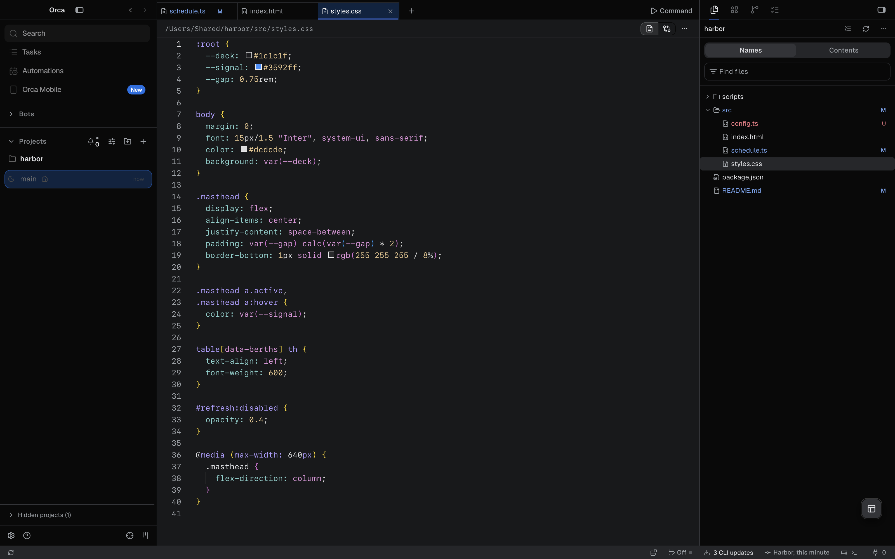
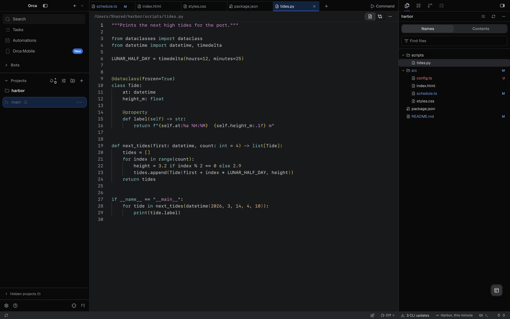

# Armada for Orca

A dark color theme for Orca, inspired by the dark themes of JetBrains Fleet and Air. It colors
the app, the code in the editor, and the terminal.


## Install

In Orca, open Settings → Plugins and install **Armada for Orca**. Or from a terminal:

```sh
orca plugin install DavidSeptimus/armada-theme-orca-plugin
```

Then choose **Armada** under Settings → Appearance. Its terminal colors are offered alongside it.

`orca plugin uninstall davidseptimus.armada-theme` removes it.

## Screenshots

| | |
| --- | --- |
|  |  |
|  |  |
|  |  |
|  |  |
|  | |

## License

MIT. See [LICENSE](LICENSE).
