# Armada for Orca

Two color themes for Orca, inspired by the themes of JetBrains Fleet and Air: Armada, which is
dark, and Armada Light. Each colors the app, the code in the editor, and the terminal.

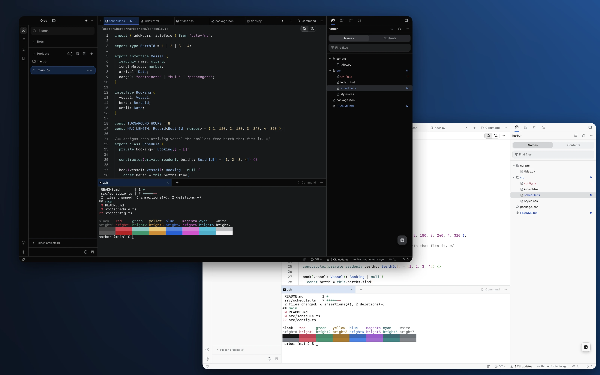

## Install

In Orca, open Settings → Plugins and install **Armada for Orca**. Or from a terminal:

```sh
orca plugin install DavidSeptimus/armada-theme-orca-plugin
```

Then, under Settings → Appearance, choose **Armada** as the dark theme and **Armada Light** as the
light theme. Their terminal colors are offered alongside them.

`orca plugin uninstall davidseptimus.armada-theme` removes it.

## Screenshots

| Armada | Armada Light |
| --- | --- |
| 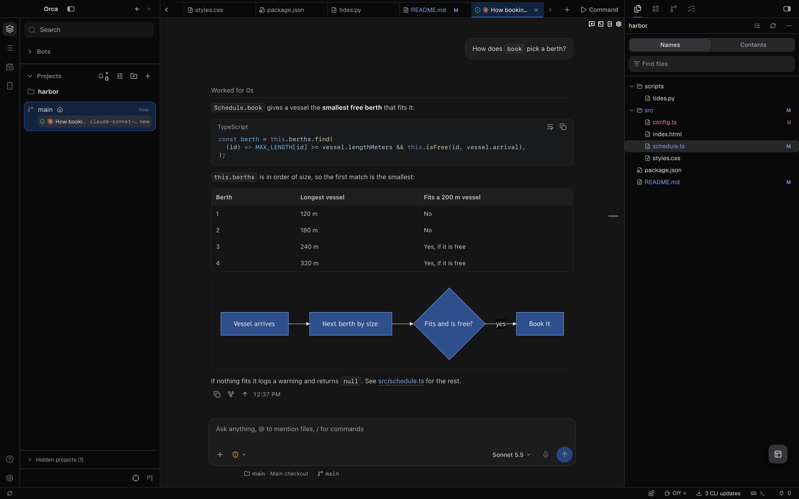 |  |
| 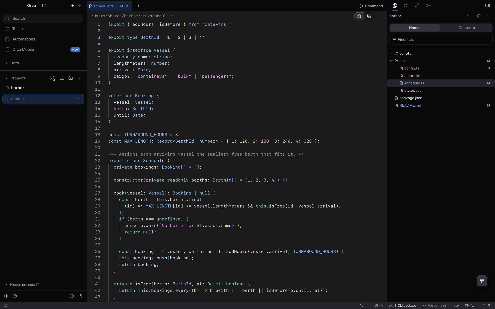 |  |
|  | 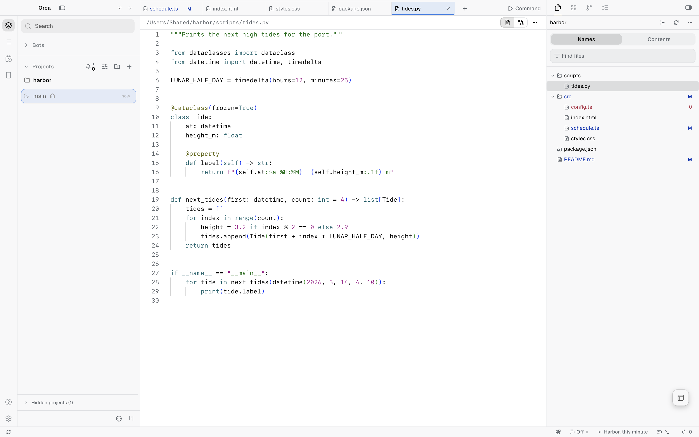 |
|  | 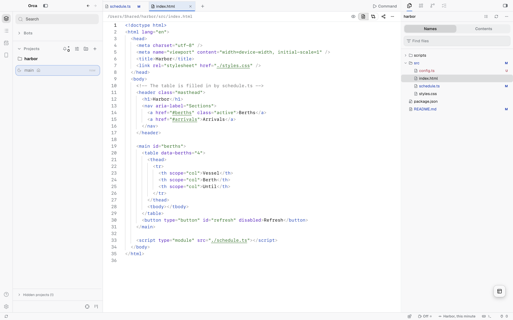 |
|  | 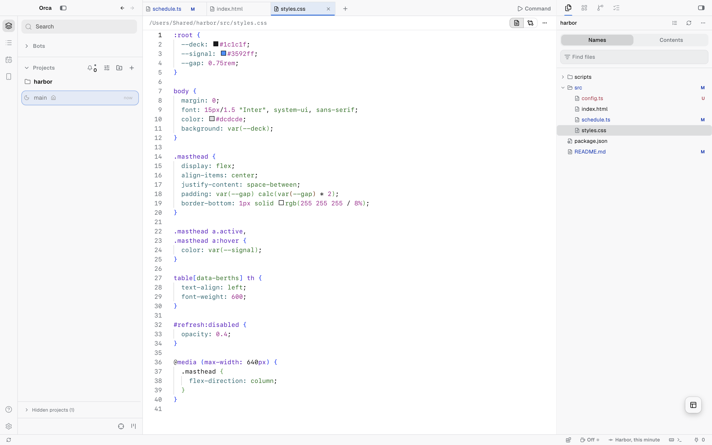 |
|  | 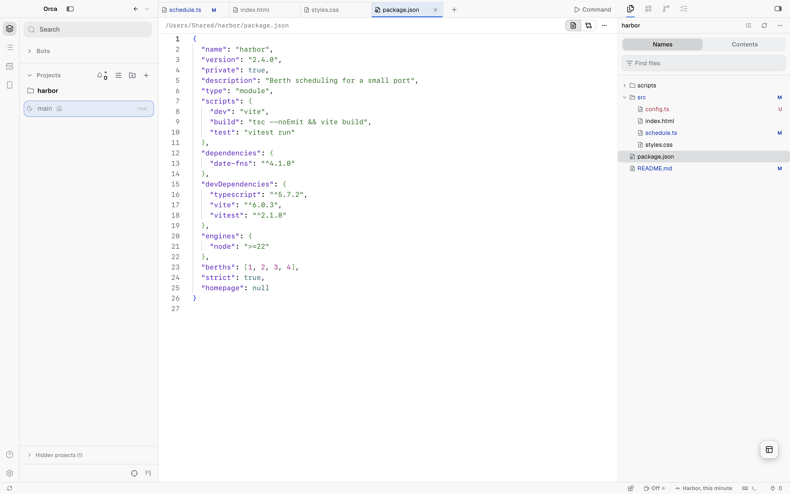 |
|  | 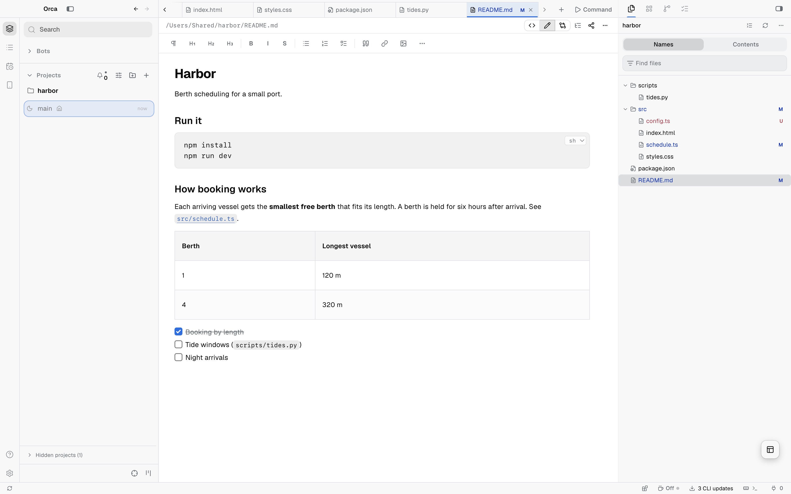 |
| 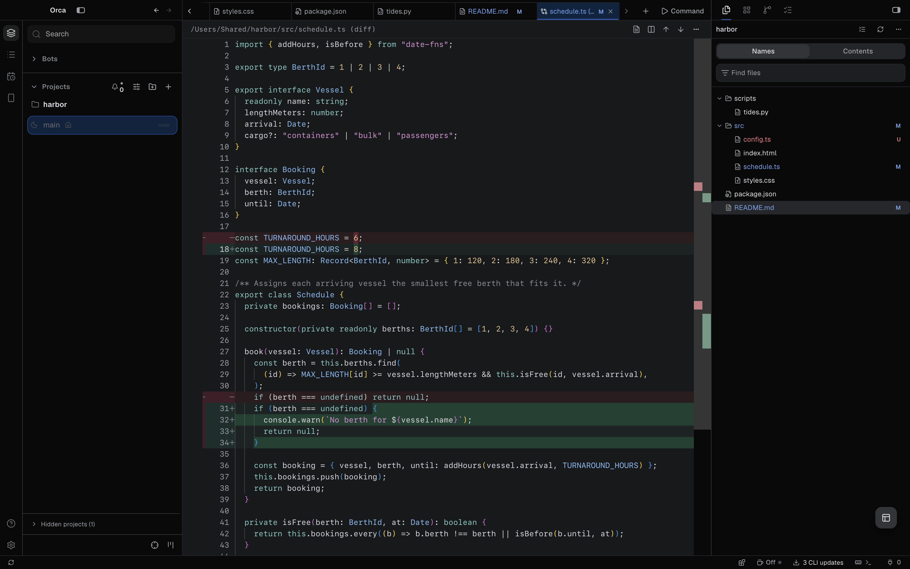 |  |
| 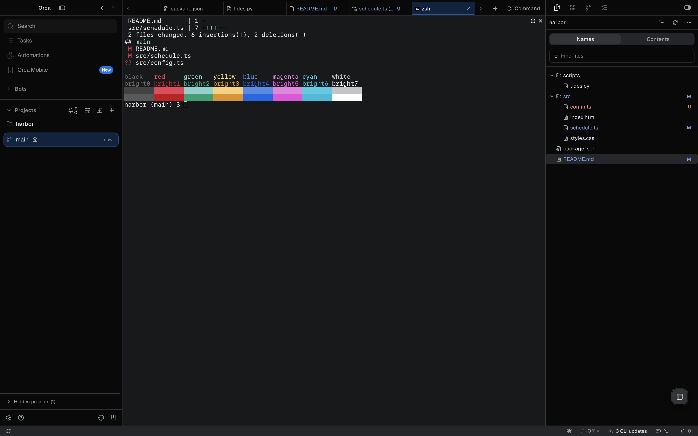 | 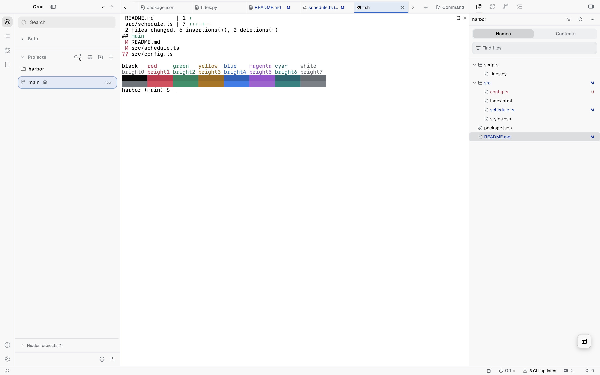 |

## License

MIT. See [LICENSE](LICENSE).
