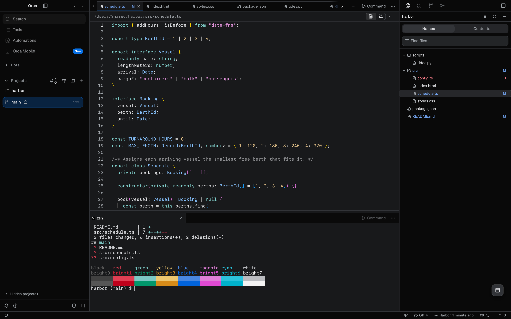

# Armada for Orca

The Armada dark theme as an Orca plugin: an app theme, its code colors, and a terminal palette.

Choose it under Settings → Appearance. Its terminal colors are offered alongside it.



More: [TypeScript](screenshots/typescript.png), [HTML](screenshots/html.png),
[CSS](screenshots/css.png), [JSON](screenshots/json.png), [Python](screenshots/python.png),
[Markdown](screenshots/markdown.png), [a diff](screenshots/diff.png),
[the terminal](screenshots/terminal.png).

## Install from this folder

```sh
orca plugin install /path/to/armada-theme-orca-plugin
```

`orca plugin uninstall davidseptimus.armada-theme` removes it.

## How it is built

Everything under `themes/` and `terminal/`, and `orca-plugin.json`, is generated. The source of
truth for the colors is Tachi Code's Armada theme (`armada.ts`), which is also what the VS Code
extension is built from. It provides the theme and its named palette. What is Orca's own lives in
`src/`.

```sh
npm run build [-- <path to armada.ts>]   # defaults to ../tachi-code/src/entrypoints/code/shiki/themes/armada.ts
npm run validate                         # orca plugin validate .
```

The manifest's id, name, version and description come from `package.json`.

### App colors

Orca themes set about 70 CSS variables (`--background`, `--sidebar`, `--tab-active` and so on).
They are written by hand against Armada's named palette, in `src/app-tokens.mjs`. They are not
derived from the theme's VS Code workbench colors, several of which are
shaped for VS Code's own parts.

Orca drops any text and surface pair under 4.5:1 contrast and paints its own colors instead, and
likewise a line or focus ring under 2:1 on what it marks. The build runs the same checks and
fails on one that is under the floor.

### Code colors

They come from the theme's `tokenColors`, plus `src/token-colors.mjs` for the colors Armada
gives one language, which Orca's built-in languages can only get through rules that name the
editor's own tokens. Orca reads less than VS Code does, and caps a theme file at
16 KiB, so the build cuts the list down:

1. Selectors with a parent scope (`meta.class.body.java variable.other`) are dropped. Orca does
   not read them, nor semantic token colors.
2. A selector that only repeats the style of its parent scope is dropped.
3. A color under 3:1 on the editor, which Orca would replace with its own, is moved toward the
   editor text until it passes.
4. What is left is added until the file is full, in this order:
   - the rules of `src/token-colors.mjs`;
   - the scopes Orca's built-in languages read. Orca's editor is Monaco, whose languages report
     a short list of token names, and Orca colors each through one TextMate scope;
   - the scopes that belong to no one language;
   - each language in `LANGUAGE_ORDER` in `scripts/build-theme.mjs`, whole or not at all;
   - the rest.

The build prints what it dropped, lifted and cut. Scopes that belong to one language are read
only by a syntax plugin that hands Orca raw TextMate scopes, so a language that is cut loses
nothing in Orca's built-in highlighting.

### Terminal colors

The theme's `terminal.*` workbench colors, under Orca's names for them.

## Screenshots

```sh
npm run screenshots
```

This rebuilds everything under `screenshots/` from the plugin as it is in this folder, so run
`npm run build` first. It starts a second copy of Orca whose window is never shown, on a throwaway
profile with its own home folder, so the Orca you are working in is not touched and can stay open.
It installs the plugin there, selects the theme, opens the files of `scripts/sample-project` one
by one and saves a picture of each. The last one, `cover.png`, is the one for the listing:
a file with a terminal below that prints git output and the 16 terminal colors, the same test the
pictures of Orca's own themes use. The second Orca, its profile and the copy of the sample
project are removed at the end.

macOS only. The switch that gives Orca a separate profile is the one its own end-to-end tests use.
It is not a documented option, so an Orca update can break the script.

## License

MIT. See [LICENSE](LICENSE).
